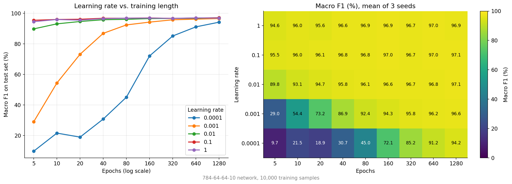
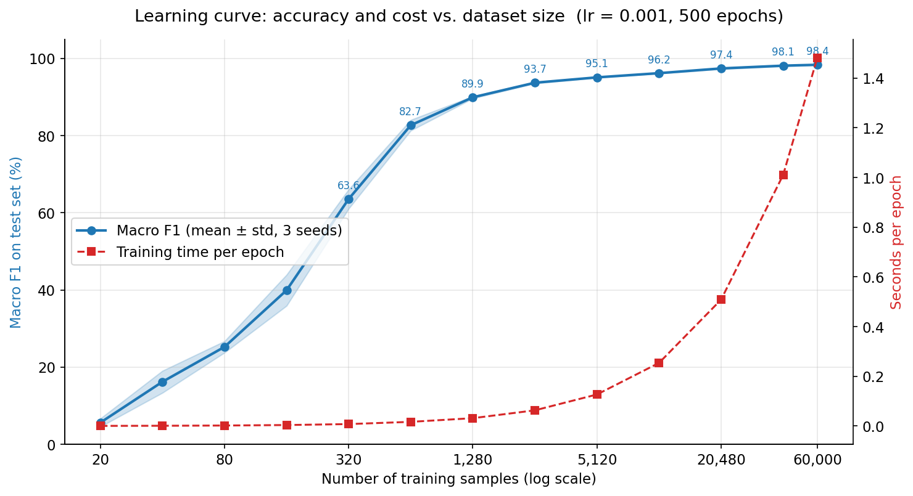
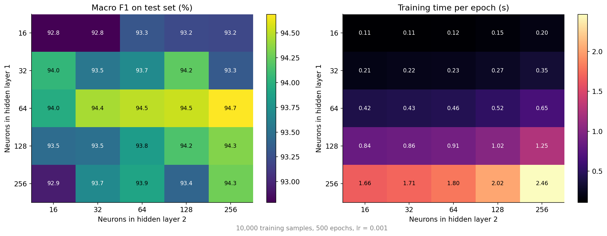
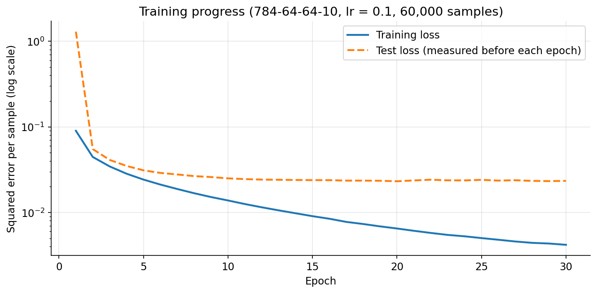

# Neural Network from Scratch in C — MNIST Digit Recognition

A fully connected neural network written in plain C, with **no ML libraries**. It is trained with
backpropagation and stochastic gradient descent to recognise handwritten digits from the
[MNIST](https://en.wikipedia.org/wiki/MNIST_database) dataset. The repository also includes a
Python toolchain for systematic hyperparameter experiments and their analysis.

**Result:** a `784 → 64 → 64 → 10` network reaches **97.3 % accuracy on the full 10,000-image MNIST
test set** after 30 epochs (macro F1 97.25 %). In a longer experiment (500 epochs, evaluated on 3,000 test images) it reached **98.4 % macro F1**.

<p align="center">
  
</p>

## Highlights

- **Everything implemented by hand:** forward pass, backpropagation, the gradient descent update,
  weight initialisation, model serialisation, CSV parsing, and the evaluation metrics (confusion matrix,
  per-class precision / recall / F1, macro averages).
- **Configurable architecture:** any number and size of hidden layers via `--hidden 128,64,32`.
- **Reproducible:** seeded weight initialisation, a script that downloads MNIST, every
  experiment logged as CSV, and one command per experiment to re-run it and regenerate its figure.
- **Empirical study:** about 200 training runs exploring learning rate, training length, dataset size, and
  network width. Key sweeps were repeated over 3 random seeds.
- **Memory-safe:** the code compiles warning-free with `-Wall -Wextra -Wpedantic` and runs cleanly
  under AddressSanitizer / UBSan (`make debug`).

## Quick start

Requirements: a C11 compiler (clang or gcc), `make`, and Python 3 (for the data download and plots).

```bash
git clone https://github.com/hildebrandnico/mnist-neural-network-c.git
cd mnist-neural-network-c

make data      # downloads MNIST (~130 MB as CSV) into ./data
make           # builds ./mnist-nn
make run       # trains 784-64-64-10 for 30 epochs and evaluates on the test set
```

Example output (shortened):

```
Architecture: 784 -> 64 -> 64 -> 10   (epochs: 30, learning rate: 0.1, seed: 42)
Epoch   30 / 30   train loss: 0.004189   test loss: 0.023386
Training time: 4.495 s per epoch

Accuracy: 97.28%  (9728 / 10000 correct)

Confusion matrix (rows = actual, columns = predicted):
           0     1     2     3     4     5     6     7     8     9  | recall     F1
--------------------------------------------------------------------+--------------
   0     973     0     1     0     0     2     2     0     1     1  |  99.29   98.04
   1       0  1122     0     6     0     2     1     1     3     0  |  98.85   98.99
   ...
   9       3     2     1     5     9     4     0     9    12   964  |  95.54   96.50

Macro precision: 97.27%   macro recall: 97.25%   macro F1: 97.25%
```

### Command-line options

```
./mnist-nn --hidden 128,64 --epochs 50 --lr 0.05 --train-n 20000 --seed 1
./mnist-nn --load output/model.csv            # evaluate a saved model without training
./mnist-nn --save-misclassified               # dump wrongly classified digits for inspection
./mnist-nn --help                             # all options
```

Each training run writes to `output/`:

| File | Content |
|---|---|
| `model.csv` | trained weights and biases (can be reloaded with `--load`) |
| `loss.csv` | training and test loss per epoch |
| `experiments.csv` | one row per run: hyperparameters, time per epoch, accuracy, macro P/R/F1 |
| `misclassified.csv` | pixels + true/predicted label of every wrong prediction (optional) |

## How it works

```
input (28×28 = 784 pixels, scaled to [0,1])
  → hidden layer 1 (sigmoid)
  → hidden layer 2 (sigmoid)
  → output layer: 10 neurons (sigmoid), prediction = argmax
```

| Component | Choice |
|---|---|
| Activation | Sigmoid, σ(z) = 1 / (1 + e^(−z)) |
| Loss | Squared error against a one-hot target, ½ Σ (t − a)² |
| Optimiser | Per-sample stochastic gradient descent |
| Initialisation | Weights ~ U(−0.5, 0.5), biases = 0 |

**Backpropagation** (`src/network.c`):

1. Output layer: δ = (a − t) · σ'(z), where σ'(z) = a(1 − a)
2. Hidden layers, going backwards: δⱼ = (Σₖ δₖ · wₖⱼ) · σ'(zⱼ)
3. Update: w ← w − η · δ · a_prev,  b ← b − η · δ

### Project structure

```
src/
  main.c        command-line interface, training/evaluation pipeline, result logging
  network.c/h   network data structures, forward pass, backpropagation, training loop, save/load
  dataset.c/h   CSV loading and pixel normalisation
  metrics.c/h   confusion matrix, precision / recall / F1, formatted report
scripts/
  download_mnist.py   fetches MNIST and converts it to CSV (standard library only)
  run_experiments.py  re-runs the hyperparameter sweeps below (one preset per experiment)
  plot_results.py     generates the figures below from results/*.csv
results/        raw CSV data of all experiments shown in this README
docs/images/    generated figures
```

## Experiments

Unless stated otherwise, the experiments use a `784-64-64-10` network evaluated on 3,000 MNIST test
images. All raw data is in [`results/`](results/), and `python3 scripts/plot_results.py` regenerates
every figure. To re-run an experiment from scratch:

```bash
pip install -r requirements.txt
python3 scripts/run_experiments.py --list         # lr_epochs, train_size, hidden_layer_sizes, default_loss
python3 scripts/run_experiments.py train_size     # writes results/train_size.csv (takes roughly 1–2 hours)
python3 scripts/plot_results.py
```

### 1. Learning rate vs. number of epochs

*(figure at the top: 10,000 training samples, 5 learning rates × 9 epoch counts × 3 seeds = 135 runs)*

- With **η = 0.1–1.0** the network reaches ≈ 95 % macro F1 after only 5 epochs.
- **η = 0.0001** needs more than 1,000 epochs to come close to the same result. It is the same model, but it needs over 250× more epochs.
- With long training all learning rates from 1.0 to 0.001 end up in a narrow band (96–97 %).
  Here the learning rate mainly decides *how fast* the network gets there, not how good it ends up.

### 2. Amount of training data

<p align="center"></p>

- Accuracy rises steeply up to ~1,000 samples (≈ 90 %) and then flattens: going from 5,120 to 60,000
  samples (11.7× the data) adds only ~3.3 percentage points (95.1 % → 98.4 %).
- Training time per epoch grows linearly with the dataset size, so the last few percentage points are by far the
  most expensive ones.
- The best result of all experiments: **98.4 % macro F1** with all 60,000 training images.

### 3. Network width

<p align="center"></p>

- All 25 configurations from 16 to 256 neurons per layer land between 92.8 % and 94.7 %. With this
  amount of data (10,000 samples), width matters much less than learning rate or data size.
  (These are single-seed runs, and differences below ~0.5 pp are within seed-to-seed noise.)
- Cost is dominated by the **first** hidden layer, because it holds 784 × h₁ weights: going from 16 to 256 neurons
  there makes each epoch ~15× slower, while the second layer barely matters.
- `64-256` gave the best score, while `64-64` gives nearly the same result at 70 % of the cost.

### 4. Overfitting

<p align="center"></p>

With all 60,000 samples and η = 0.1, the training loss keeps falling steadily, but the test loss
plateaus after ~10 epochs. After that the network mostly memorises the training set. The
remaining errors come mostly from visually similar pairs (5→3, 2→8, 9→8, 7→2; see the confusion matrix above).

## Limitations and next steps

This was my first larger C project, so it deliberately puts clarity first, not speed. Things I would
improve next:

- **Proper validation split.** The test set is currently used to monitor the loss and compare
  hyperparameters. A separate validation set would make the reported test numbers fully unbiased.
- **Softmax + cross-entropy** instead of sigmoid + squared error, for better-behaved gradients in the
  output layer.
- **Shuffling and mini-batches.** Samples are currently presented in a fixed order, one at a time.
- **Performance.** Storing each layer as one contiguous weight matrix instead of an array of
  neuron structs would be much friendlier to the CPU cache. It would also allow vectorised matrix
  operations (e.g. with Apple's Accelerate / BLAS) and multithreading.
- **Unit tests**, e.g. a numerical gradient check that verifies the backpropagation against finite differences.

## Background

I built this project during my first semester at university as part of a course on the
foundations of artificial intelligence. The goal was to understand neural networks from first principles,
without relying on frameworks such as PyTorch or TensorFlow.

## License

[MIT](LICENSE)
